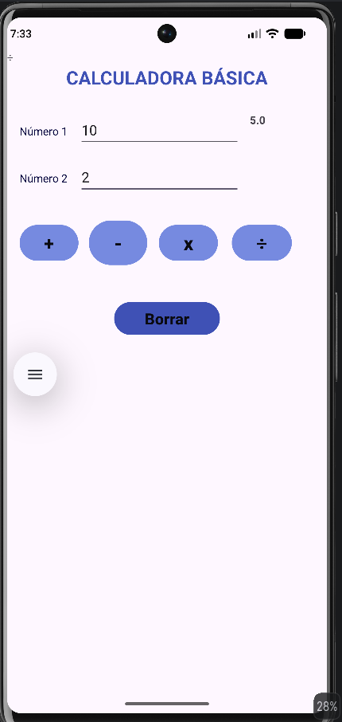

# Calculadora básica – Android (Java)

Aplicación Android que realiza las cuatro operaciones básicas (suma, resta, multiplicación y división) con dos números introducidos por el usuario. Controla la división entre cero.

## Captura

## Tecnologías
Java · Android Studio · Layouts XML (ConstraintLayout)

## Estado
Primera versión, desarrollada como ejercicio de 2º DAM.

## Mejoras pendientes
- Validar campos vacíos para evitar errores
- Limitar la entrada a valores numéricos
- Limpiar también el resultado al pulsar «Borrar»
- Mostrar el resultado más grande y visible
- Unificar el tamaño de los botones y eliminar elementos sobrantes del layout
- Adaptar el diseño a distintos tamaños de pantalla
- Migrar a ViewBinding
